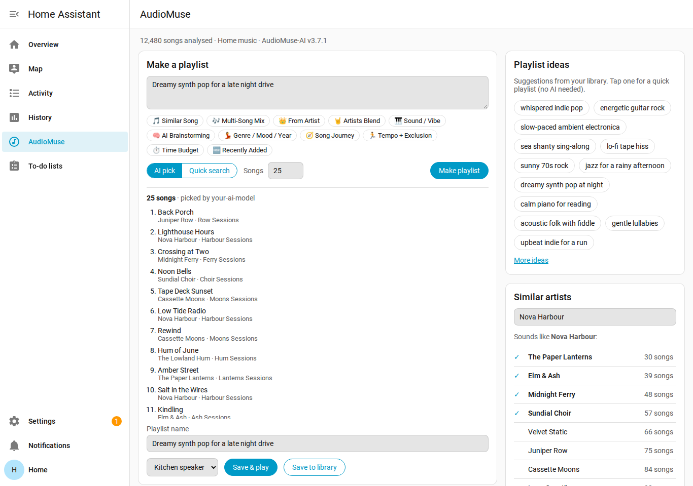
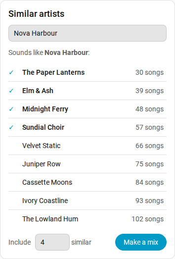
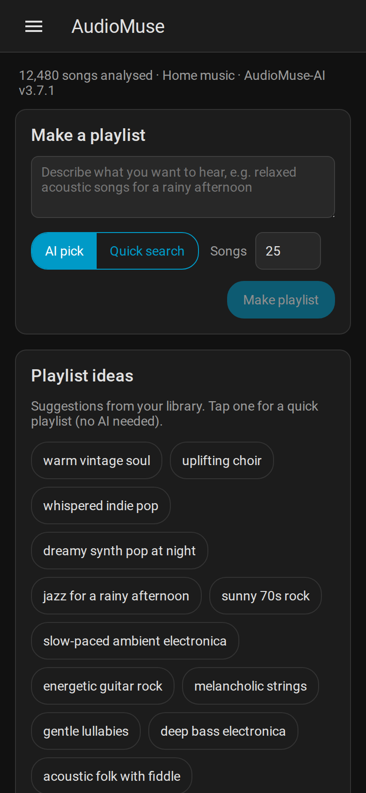

# AudioMuse-AI for Home Assistant

[](https://github.com/colfin22/ha-audiomuse/actions/workflows/validate.yml)
[](https://github.com/colfin22/ha-audiomuse/actions/workflows/tests.yml)

A Home Assistant integration for [AudioMuse-AI](https://github.com/NeptuneHub/AudioMuse-AI), the self-hosted sonic-analysis engine for your music library. It adds an **AudioMuse** page to the Home Assistant sidebar for making playlists from your own music. Playlists are saved to your music server, so they show up in every music app, and can be played straight away on your speakers through [Music Assistant](https://www.music-assistant.io/).



## Features

- **Make a playlist**
  - Describe what you want to hear ("dreamy synth pop for a late night drive").
  - **AI pick** lets AudioMuse-AI's AI choose the songs.
  - **Quick search** uses AudioMuse-AI's text search instead: faster, and no AI needed.
- **Suggestions:** the same starting points as AudioMuse-AI's Instant Playlist page (Similar Song, Multi-Song Mix, From Artist, Genre / Mood / Year, Song Journey and more). Tap one to fill the request box, then edit it.
- **Playlist ideas:** AudioMuse-AI's own suggestions. Tap one for an instant playlist.
- **Similar artists:** search your artists, see who sounds like them, and make a mix of an artist plus the closest-sounding ones.
- **Radios:** refresh your saved AudioMuse-AI Radios into playlists.
- **Recent:** playlists saved from Home Assistant, ready to play again.
- **Save to library, or Save & play** on any Music Assistant speaker.
- **Sensors:** songs, albums and artists analysed, busy workers, queued tasks and version.
- **Actions** for automations, scripts and voice. Every one returns its results.
- Follows your Home Assistant theme, light or dark, and works on phones and wall tablets.

| Similar artists | On a phone, dark theme |
|---|---|
|  |  |

## Requirements

- **AudioMuse-AI 3.7.1 or newer**, reachable from Home Assistant, with your library analysed. Results only cover analysed songs.
- **Home Assistant 2025.2 or newer.**
- **For playback on speakers (optional):** the [Music Assistant](https://www.home-assistant.io/integrations/music_assistant/) integration, with your music server added as a Music Assistant provider. See [Music servers](#music-servers).
- **For AI pick (optional):** an AI provider configured **in AudioMuse-AI** (OpenAI-compatible, Ollama, Gemini or Mistral).
  - Choose a model that supports tool calling; AudioMuse-AI requires it.
  - Your AI key stays in AudioMuse-AI.
  - Quick search, ideas, similar artists and Radios all work without AI.

## Installation

### Marketplace (Home Assistant 2026.11 and newer)

Since 2026.11, HACS is built into Home Assistant as the **Marketplace**.

1. Go to **Settings → Marketplace**.
2. In the upper-right corner, select **Add from link**, enter `https://github.com/colfin22/ha-audiomuse` and select **Add**. The Marketplace asks you to connect GitHub the first time.
3. Install **AudioMuse-AI**, then restart Home Assistant.

### HACS (Home Assistant 2026.10 and older)

1. In HACS, open the ⋮ menu → **Custom repositories**.
2. Add `https://github.com/colfin22/ha-audiomuse` with the type **Integration**.
3. Find **AudioMuse-AI** in HACS, select **Download**, then restart Home Assistant.

### Manual

Copy `custom_components/audiomuse` into your Home Assistant `config/custom_components/` folder and restart Home Assistant.

## Setup

1. Go to **Settings → Devices & services → Add integration → AudioMuse-AI**.
2. Enter the AudioMuse-AI address, for example `http://audiomuse.local:8000`.
3. If authentication is enabled in AudioMuse-AI, enter its **API token**. You'll find it under AudioMuse-AI → **Setup Wizard** → *API token*. Leave it empty if authentication is off.

The **AudioMuse** page appears in the sidebar as soon as a server is added. To change the defaults, open the integration and select **Configure**:

| Option | What it does |
|---|---|
| Songs per playlist | Default number of songs. |
| Default speaker | The Music Assistant speaker the page starts with, and actions use when none is given. |
| AI provider / model / server URL | Override AudioMuse-AI's own AI settings for AI pick. Leave empty to use AudioMuse-AI's. |
| Music Assistant provider | Rarely needed. Set it to a Music Assistant provider instance ID if playback fails or you have several providers of the same kind. |

## Actions

| Action | What it does | Returns |
|---|---|---|
| `audiomuse.instant_playlist` | Songs for a request, by AI pick (`mode: ai`) or quick search (`mode: search`). Saves the playlist and can start it on a speaker. | `tracks`, `playlist_id`, `playlist_name`, `played_on`, `ai_model` |
| `audiomuse.artist_playlist` | A mix of an artist plus the most similar-sounding artists. | `artists`, `tracks`, `playlist_id`, `playlist_name` |
| `audiomuse.similar_artists` | Artists that sound like the one given. | `artists` |
| `audiomuse.playlist_ideas` | AudioMuse-AI's suggested prompts. | `ideas` |
| `audiomuse.run_radios` | Refresh every enabled Radio into a playlist. | run summary |
| `audiomuse.play_playlist` | Play a saved playlist on a Music Assistant speaker. | `played_on` |

AudioMuse-AI adds `_instant` to the names of playlists it saves.

### Example: a playlist from a button or voice command

```yaml
action: audiomuse.instant_playlist
data:
  prompt: "Relaxed acoustic songs for a rainy afternoon"
  mode: search          # or "ai" to let the AI pick
  count: 20
  play_on: media_player.kitchen
response_variable: playlist
```

`playlist.tracks` holds the songs and `playlist.playlist_name` the saved name.

## Sensors

| Sensor | Meaning |
|---|---|
| Songs analysed / Albums analysed / Artists analysed | How much of the library AudioMuse-AI has analysed. |
| Busy workers | AudioMuse-AI workers currently working (attribute: task types). |
| Queued tasks | Tasks waiting in AudioMuse-AI's queue. |
| Unanalysable songs | Songs AudioMuse-AI could not analyse (diagnostic). |
| Version | AudioMuse-AI version and music server (diagnostic). |

## Music servers

Everything except playback works with every music server AudioMuse-AI supports. AudioMuse-AI does the work and saves playlists to the server itself. Playback goes through Music Assistant, so it depends on Music Assistant having a provider for your server:

| Music server | Playlists, artists, ideas, Radios, sensors | Play on a speaker (Music Assistant) |
|---|---|---|
| Navidrome | ✅ | ✅ tested |
| Jellyfin | ✅ | 🧪 should work, not yet tested |
| Emby | ✅ | 🧪 should work, not yet tested |
| Plex | ✅ | 🧪 should work, not yet tested |
| Lyrion | ✅ | ❌ Music Assistant has no Lyrion music provider |

🧪 means built from the Music Assistant provider source but not yet confirmed on a real server. **Testers wanted:** if you use Jellyfin, Emby or Plex, please try **Save & play** and report the result in an [issue](https://github.com/colfin22/ha-audiomuse/issues).

A playlist made a moment ago plays straight away. The integration asks Music Assistant for it by its music-server ID, so it doesn't wait for a Music Assistant library sync.

## Troubleshooting

| You see | What to do |
|---|---|
| **AI pick is greyed out** | AudioMuse-AI has no AI provider. Set one in AudioMuse-AI's Setup Wizard, or in this integration's options. Quick search works meanwhile. |
| **"AudioMuse-AI isn't ready for this yet"** | AudioMuse-AI is still building its search indexes after analysis. Similar artists and searches work once its first analysis batch has finished. |
| **"AudioMuse-AI rejected the request"** | Authentication is enabled in AudioMuse-AI. Enter its API token, or update it if it changed (Home Assistant will ask you to). |
| **No "Save & play" button** | Install the Music Assistant integration, with your music server as a provider. Lyrion servers can't be played through Music Assistant. |
| **Playback fails on Jellyfin, Emby or Plex** | Set **Music Assistant provider** in the options to your provider's instance ID, and please open an issue. |
| **AI pick returns odd songs or errors** | Use a model that supports tool calling. |

## How this relates to Music Assistant's AudioMuse-AI plugin

Music Assistant has its own AudioMuse-AI plugin, which provides similar tracks, an "Inspired by recently played" row and free-text search inside Music Assistant. This integration is complementary: it brings AI and quick-search playlists, artist mixes, playlist ideas, Radios, sensors and actions into Home Assistant itself. You can use both.

## Privacy

- The integration talks only to your AudioMuse-AI server and, for playback, to Music Assistant inside Home Assistant.
- It never changes AudioMuse-AI's settings.
- Your AI key never leaves AudioMuse-AI.
- Playlists are created by AudioMuse-AI on your music server, with AudioMuse-AI's own music-server account.

## Development

The sidebar page is written in TypeScript with [Lit](https://lit.dev) and bundled with esbuild into `custom_components/audiomuse/frontend/audiomuse-panel.js`. The bundle is committed, so HACS users need no build step, and CI checks it matches the source.

```bash
cd frontend
npm ci
npm run build   # type-check and bundle
```

Tests run with `pytest`. `pip install -r tests/requirements.txt` is enough for the client tests; add `pytest-homeassistant-custom-component` and the `home-assistant-frontend` version its Home Assistant pins to run the Home Assistant tests too (see `.github/workflows/tests.yml`).

## Licence

MIT
